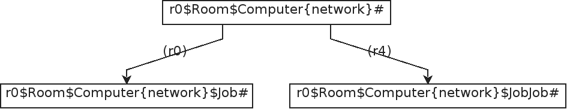
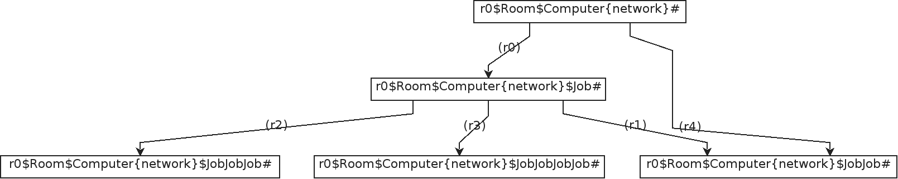

This section introduces the model-checking facilities provided by the Bigraph Framework and explains how bigraphical reactive systems can be systematically analyzed.

It first covers the specification of the reactive system and configuration of the model checker, then explains how the reachable state space is explored and controlled at runtime.
Finally, it shows how the resulting reaction graph can be inspected programmatically and exported for further analysis or visualization.


## Overview
In software engineering,
*formal verification* is a technique
for ensuring the correctness of programs using mathematical models and methods.
Unlike traditional testing approaches,
formal verification provides rigorous guarantees about a program's behavior
by proving specific properties against a formal specification.

In this process,
a program or a system (formulated as bigraphical reactive system) is checked against a set of correctness properties.
A system is considered correct with respect to a given specification if the required properties hold for its formal model.
This method is particularly valuable for developing safe and reliable software,
as it can identify errors that might be missed by conventional techniques like unit testing.

One widely used formal verification technique is *model checking*, which systematically explores the reachable state space of a system to determine whether specified properties hold. This functionality is integrated into the simulation module of *Bigraph Framework*.

## Creating the Specification and a Model Checker

### Bigraphical Reactive System (BRS)

A BRS is a model of a system or system specification containing an initial host bigraph and a collection of reaction rules.

:::info Definition (after [\[4\]](#ref4))
In category-theoretic terms, BRSs are defined as syntactical categories endowed with a set of reaction rules.
Specifically, a concrete BRS is a s-category  containing a signature and a set of rules.
:::

All reactive system implementations extend the interface `org.bigraphs.framework.core.reactivesystem.ReactiveSystem<B extends Bigraph<? extends Signature<?>>>` of the Core Module in Bigraph Framework.

#### Creating a BRS by Instantiation

A reactive system for _pure bigraphs_ can be created by calling its constructor as follows:

```java
PureReactiveSystem reactiveSystem = new PureReactiveSystem();
```

Then, an initial bigraph and reaction rules can be added like this:
```java
// Set the initial agent
PureBigraph agent = ...;
reactiveSystem.setAgent(agent);
// Add a reaction rule
ReactionRule<PureBigraph> rr = ...;
reactiveSystem.addReactionRule(rr);
```

:::info Format of a Bigraphical State
In the bigraph theory, an _agent_ is any _ground bigraph_, i.e., a bigraph that has no sites and inner names.
It must also be *prime*, i.e., it must have only _one root_.

In Bigraph Framework, an _agent_ is generally referred to as a _state_ of a system.
:::

:::note Exceptions
An exception will be thrown if the rules or the initial state are not in the correct format.
:::

:::note Some further remarks
- Predicates as used in [model checking](./verification-intro) for reachability checking can be added using the method `PureReactiveSystem#addPredicate(ReactiveSystemPredicates<B> predicate)`.
- See also [here](simulation-predicates) on how to create predicates.
:::

#### Creating a BRS by Inheritance

Inheriting a reactive system implementation allows for an object-oriented approach to better organize and manage domain-specific BRSs in an application.

The [following example](https://github.com/bigraph-toolkit-suite/bigraphs.bigraph-framework/blob/main/simulation/src/test/java/org/bigraphs/framework/simulation/examples/computation/AddExample.java#L85) defines a BRS that can compute the sum of two integers, which are represented in bigraphs in [unary form](https://en.wikipedia.org/wiki/Peano_axioms).
In this form the symbol _S_ is used to denote successor, and _Z_ to mean zero.
For example, the number 2 would be writing as _S.S.Z_.

```java
import org.bigraphs.framework.core.reactivesystem.*;
import org.bigraphs.framework.simulation.matching.pure.*;

public class AddExpr extends PureReactiveSystem {

    public AddExpr(int a, int b) throws Exception {
        setAgent(createAgent(a, b));
        addReactionRule(createReactionRule_1());
        addReactionRule(createReactionRule_2());
    }

    // Custom extended method of this reactive system specification that allows execution
    public PureBigraph execute() throws Exception {
        // Instantiate a matcher
        AbstractBigraphMatcher<PureBigraph> matcher = AbstractBigraphMatcher.create(PureBigraph.class);
        // Get the current state
        PureBigraph agentTmp = getAgent();

        // ...
        // apply rules according to some strategy or randomly
        // ...

        // Return the final state
        return agentTmp;
    }
}
```

The concrete methods `AddExpr#createAgent()`, `AddExpr#createReactionRule_1()` and `AddExpr#createReactionRule_2()` are omitted in this example for clarity.


### Creating the Model Checker

This code example shows how to create a model checker object for pure bigraphs:

```java
import org.bigraphs.framework.core.reactivesystem.*;
import org.bigraphs.framework.simulation.matching.pure.*;
import org.bigraphs.framework.simulation.modelchecking.*;

// Create a pure reactive system container
PureReactiveSystem reactiveSystem = new PureReactiveSystem();

// Add an agent (the initial state) and reaction rules (logic)
/* code omitted */

// Create model checking options
ModelCheckingOptions opts = ModelCheckingOptions.create();

// Create the pure bigraph model checker
PureBigraphModelChecker modelChecker = new PureBigraphModelChecker(
        reactiveSystem,
        BigraphModelChecker.SimulationStrategy.Type.BFS,
        opts
);

// Execute model checking synchronously.
// This call blocks until exploration terminates.
modelChecker.execute();
```

Some remarks:
- The `execute()` method blocks until the exploration terminates and may throw a `BigraphSimulationException`.
- For non-blocking execution, use `executeAsync()`, which returns a `Future` containing the resulting reaction graph; see [Asynchronous Execution](#asynchronous-execution).
- The executor used for model-checking tasks can be customized through an `ExecutorServicePoolProvider`; see [Custom Executor Service](#custom-executor-service).
- State-space exploration strategies are covered [here](#state-space-exploration) and are selected using `BigraphModelChecker.SimulationStrategy.Type` when constructing the model checker.
- Model checking options are explained [here](#configuring-and-controlling-execution).

#### Asynchronous Execution

To perform the model checking asynchronously, call the `BigraphModelChecker#executeAsync()`:

```java
import org.bigraphs.framework.core.impl.pure.*;
import org.bigraphs.framework.core.reactivesystem.*;

Future<ReactionGraph<PureBigraph>> reactionGraphFuture = modelChecker.executeAsync();
ReactionGraph<PureBigraph> pureBigraphReactionGraph = reactionGraphFuture.get();

// ...

// Retrieve the result, waiting up to 5 seconds
ReactionGraph<PureBigraph> reactionGraph = reactionGraphFuture.get(5, TimeUnit.SECONDS);
```

The `executeAsync()` method does not block the execution and returns a `Future` object to fetch the result later.
It contains the complete reaction graph of the simulated BRS.


#### Custom Executor Service

The `java.util.concurrent.ExecutorService` is used to submit tasks of the model checker.

Bigraph framework offers to provide a custom `ExecutorService` by implementing the interface
`org.bigraphs.framework.core.providers.ExecutorServicePoolProvider`, found in the `bigraph-core` dependency.
The class `BigraphModelChecker` uses the `java.util.ServiceLoader` (see [https://docs.oracle.com/javase/tutorial/ext/basics/spi.html#the-serviceloader-class](https://docs.oracle.com/javase/tutorial/ext/basics/spi.html#the-serviceloader-class)
to search for an implementation.

A default _executor service provider_ is provided within the `bigraph-simulation` module,
which creates a fixed thread pool.

Therefore,
refer to [`org.bigraphs.framework.simulation.modelchecking.FixedThreadPoolExecutorProvider`](https://bigraphs.org/software/bigraph-framework/apidocs/org/bigraphs/framework/simulation/modelchecking/FixedThreadPoolExecutorProvider.html).


## State-Space Exploration

The model checking procedure implemented in Bigraph Framework is especially suited for so-called _reachability checking_.

This topic is covered in [Bigraphical Predicates](simulation-predicates).

The framework builds the reaction graph in the course of model checking or simulation.
Only the canonical form of a bigraphical state is stored in the reaction graph to minimize the state-space explosion problem.

Specifically, a directed model-checking technique is employed.
Refer to [\[1\]](#ref1), [\[2\]](#ref2), [\[3\]](#ref3).

:::caution
Note that state-space exploration may not terminate for systems with infinite behavior.
Appropriate [stopping criteria](#stopping-criteria) should therefore be configured.
:::

### Breadth-first Traversal


[Breadth-first traversal](https://en.wikipedia.org/wiki/Breadth-first_search) explores the reachable state space level by level, starting from the initial agent.
All states reachable in one reaction step are discovered first, followed by states at increasing transition distance from the initial state.


The respective reaction graph of  [this simple BRS example](https://github.com/bigraph-toolkit-suite/bigraphs.bigraph-framework/blob/main/simulation/src/test/java/org/bigraphs/framework/simulation/ReactiveSystemUnitTests.java#L58) is shown below after the whole state space was discovered.

<center>
    <div>
        
        &nbsp;&nbsp;&nbsp;&nbsp;&nbsp;&nbsp;&nbsp;&nbsp;
        
    </div>
</center>

<br/>

The two visualizations represent the *same reaction graph*, but use different state-labeling schemes:

- *Left* uses the canonical string encoding of each bigraph as the state label. This exposes the structural representation used internally to identify and compare states at a glance.
- *Right* uses a compact state-naming scheme such as `a_0`, `a_1`, and `a_2`, which is more suited when inspecting larger systems.

The example uses three reaction rules:
- *r0*, *r1* are two identical rules that apply only to the initial configuration in which the `Computer` contains no `Job`. Each adds the first `Job` below the `Computer`.
- *r2* is a self-application rule: its redex and reactum are structurally identical. It therefore leaves the state unchanged and produces a self-loop in the reaction graph.
- *r3* applies once exactly one `Job` is present and adds a second `Job`.


### Depth-first Traversal

[Depth-first traversal](https://en.wikipedia.org/wiki/Depth-first_search) explores the reachable state space by following one successor path as far as possible before backtracking to the most recent state with unexplored alternatives.

DFS explores reachable states by following each path in depth rather than level by level, which can reduce memory overhead while still examining every global state reachable from a given initial state for a finite state space.

However, the order in which states are discovered differs from BFS, and the first path found to a state is not necessarily a shortest path.

### Random Simulation

Unlike exhaustive model-checking strategies, random simulation does not aim to discover every reachable state.

Starting from the initial agent, the simulator applies the available reaction rules, expands the reaction graph, randomly selects one successor state, and repeats the process. In this way, it follows a single randomly chosen execution path until no further rule can be applied or another stopping condition is reached.

Because only one path is explored at a time, random simulation does not guarantee complete state-space coverage or termination.

The two runs illustrate the non-deterministic nature of random simulation:

|Random Run #1 | Random Run #2 |
|---|---|
|||

- In *Random Run #1*, the initial agent has two possible successor states produced by rules `r0` and `r4`. The simulator randomly selects the successor reached via `r4`. Since no further reaction rule is applicable to that state, the run terminates immediately.

- In *Random Run #2*, the simulator instead selects the successor reached via `r0`. From this state, additional reaction rules become applicable, and the execution continues along a longer path before eventually reaching a terminal state.

These runs show that different random choices can lead to different execution paths (i.e., traces), even when starting from the same initial agent.

As shown in the figures, all *successor states* at the current level are expanded *before* the simulator randomly selects the next state to continue from.

### Variations

For example, if rule *r0* has n possible matches in state `a_0`, standard BFS or DFS may generate:

<center>
    
</center>

For breadth-first and depth-first exploration, the framework also provides the variants:

- `BigraphModelChecker.SimulationStrategy.Type.BFS_FIRST_MATCH`
- `BigraphModelChecker.SimulationStrategy.Type.DFS_FIRST_MATCH`

Instead of expanding all matches of some rule, the model checker follows only the first match found for that rule application.
This can substantially reduce branching in situations where one rule gives rise to many structurally similar successor states.


## Configuring and Controlling Execution

### Model Checking Options

Model checking options may be provided to the model checker.
Therefore, the class `ModelCheckingOptions` needs to be created. An
example is shown below.

```java
import org.bigraphs.framework.simulation.modelchecking.*;

ModelCheckingOptions opts = ModelCheckingOptions.create();
opts
        .doMeasureTime(true) // for debugging
        .setReactionGraphWithCycles(true)
        .and(transitionOpts()
                .setMaximumTransitions(100) // maximum transition count
                .setMaximumTime(100) // in seconds
                .allowReducibleClasses(true) // default: true
                .rewriteOpenLinks(false) // default: false
                .create()
        )
        .and(ModelCheckingOptions.exportOpts()
                .setReactionGraphFile(Paths.get("transition_graph.png").toFile()) // default: empty
                .setOutputStatesFolder(Paths.get("states/").toFile()) // default: empty
                .setFormatsEnabled( // output formats of states
                        List.of(
                                ModelCheckingOptions.ExportOptions.Format.PNG,
                                ModelCheckingOptions.ExportOptions.Format.XMI
                        )
                )
                .setPrintCanonicalStateLabel(false) // default: false
                .create()
        )
;
```

The individual options are divided into several categories which can be accessed by
their respective builder classes.
Currently, the following categories are available:

- `ModelCheckingOptions.TransitionOptions`
- `ModelCheckingOptions.ExportOptions`


The `ModelCheckingOptions.ExportOptions` class allows specifying a file path where the reaction graph (i.e., transition system)
and the individual states shall be written to.
If these options are left empty then the graphs are not exported.
Also, one can decide if the state labels of the reaction graph are simple identifiers _a<sub>1</sub>_, _a<sub>2</sub>_, _a<sub>3</sub>_, ... or [canonical string encodings of bigraphs](https://link.springer.com/article/10.1007/s42979-021-00552-5).
Note that these canonical labels can be quite long for large states.

The following methods are available through the `ModelCheckingOptions.transitionOpts()` builder instance to adjust the [canonical string encoding algorithm of bigraphs](https://link.springer.com/article/10.1007/s42979-021-00552-5), which is used for cycle checking of the transition system:
- `TransitionOptions.Builder#allowReducibleClasses(bool)`
- `TransitionOptions.Builder#rewriteOpenLinks(bool)`


### Stopping Criteria

Notice that `ModelCheckingOptions.TransitionOptions` let us specify some stopping criteria by
acquiring its builder by calling `ModelCheckingOptions.TransitionOptions.transitionOpts()`:

- Maximal Number of transitions to allow
- Time

The default values are good for most of the cases.

:::tip
Stopping conditions can also be defined using [bigraphical predicates](simulation-predicates), combined with event listeners and the `requestStop()` mechanism to terminate exploration when a desired condition is detected.
:::

#### Requesting Termination


In addition to predefined stopping criteria such as a maximum number of transitions, an ongoing exploration can also be terminated programmatically.
This is useful when termination depends on information that becomes available only during execution, for example when a desired state or predicate match is detected.

Therefore, the model checking strategy interface [`ModelCheckingStrategy`](https://github.com/bigraph-toolkit-suite/bigraphs.bigraph-framework/blob/main/simulation/src/main/java/org/bigraphs/framework/simulation/modelchecking/ModelCheckingStrategy.java) exposes a [`requestStop()`](https://github.com/bigraph-toolkit-suite/bigraphs.bigraph-framework/blob/main/simulation/src/main/java/org/bigraphs/framework/simulation/modelchecking/ModelCheckingStrategy.java) method.


Strategies, such as BFS, DFS, etc., implementing [`ModelCheckingStrategySupport`](https://github.com/bigraph-toolkit-suite/bigraphs.bigraph-framework/blob/main/simulation/src/main/java/org/bigraphs/framework/simulation/modelchecking/ModelCheckingStrategySupport.java) integrate this mechanism into their exploration loop by checking an internal *running flag*:

```
while (
    isRunning &&
    !worklist.isEmpty() &&
    iterationCounter.get() < transitionOptions.getMaximumTransitions()
) {
...
}
```

Calling `requestStop()` clears this flag and therefore requests a graceful termination of the exploration once the current processing step has completed. It does not forcibly interrupt an ongoing rule match.


### Monitoring Exploration with Event Listeners

One may listen to specific events that are thrown during model checking or a simulation.
This gives the user the possibility to interact
with the *reaction graph* and fire additional actions or to log these events and evaluate them later.

Therefore, the interface [`ReactiveSystemListener<B extends Bigraph<? extends Signature<?>>>`](https://github.com/bigraph-toolkit-suite/bigraphs.bigraph-framework/blob/main/simulation/src/main/java/org/bigraphs/framework/simulation/modelchecking/BigraphModelChecker.java#L422) must be implemented and added
to a model checker instance. It provides methods to listen when a reaction rule is applied or when the verification process finished, for instance.

:::info
Event listeners are covered in more detail in [Bigraphical Predicates](simulation-predicates), including predicate evaluation, verification events, and reacting programmatically to events during state-space exploration.
:::


## Reaction Graph and Results

After model checking has completed or in-between, the generated *reaction graph* (i.e., transition system) can be obtained directly from the model checker:

```java
ReactionGraph<PureBigraph> reactionGraph = modelChecker.getReactionGraph();
```

The [`ReactionGraph`](https://github.com/bigraph-toolkit-suite/bigraphs.bigraph-framework/blob/main/core/src/main/java/org/bigraphs/framework/core/reactivesystem/ReactionGraph.java) represents the explored state space and can be analyzed programmatically.

Reaction graphs can also be compared with respect to behavioral equivalence, for example by checking whether two transition systems are bisimilar.

For further processing or visualization, the reaction graph can be exported in different formats.

### Inspecting the Reaction Graph

A `ReactionGraph` provides direct access to the generated transition system.
Internally, it is represented by a JGraphT `Graph` whose vertices are `LabeledNode` instances and whose edges are `LabeledEdge` instances.
For example, basic statistics can be obtained directly from the graph:

```java
ReactionGraph<PureBigraph> reactionGraph = modelChecker.getReactionGraph();

Graph<ReactionGraph.LabeledNode, ReactionGraph.LabeledEdge> graph =
        reactionGraph.getGraph();
System.out.println("States: " + graph.vertexSet().size());
System.out.println("Transitions: " + graph.edgeSet().size());
```

The underlying graph can also be traversed directly. For example, all transitions can be inspected together with their source and target states:

```java
for (ReactionGraph.LabeledEdge edge : graph.edgeSet()) {
    ReactionGraph.LabeledNode source = graph.getEdgeSource(edge);
    ReactionGraph.LabeledNode target = graph.getEdgeTarget(edge);

    System.out.println(source + " -> " + target);
}
```

To find all traces to terminal states:
```java
ReactionGraphAnalysis<PureBigraph> analysis = ReactionGraphAnalysis.createInstance();
List<ReactionGraphAnalysis.StateTrace<PureBigraph>> traces = analysis.findAllPathsToLeaves(reactionGraph);
traces.forEach(x -> {
    System.out.println("Path has length: " + x.getPath().size());
    System.out.println("\t" + x.getStateLabels().toString());
});
```

### Exporting Results

The resulting reaction graph can be exported to the *DOT format* for further analysis, layout processing, or rendering with external graph-visualization tools.

```java
DOTReactionGraphExporter exporter = new DOTReactionGraphExporter();

// Export as a DOT string
String dot = exporter.toString(modelChecker.getReactionGraph());

// Export directly to a file
try (FileOutputStream out = new FileOutputStream("reaction_graph.dot")) {
    exporter.toOutputStream(modelChecker.getReactionGraph(), out);
}
```

:::info
When the corresponding model-checking export options are configured, PNG export is performed automatically after exploration.

The reaction graph can also be exported directly as a PNG image.
For further details, refer to [Visualization](../visualization/visualization-intro)
:::

## References

- \[1\] <a id="ref1" href="https://dl.acm.org/citation.cfm?doid=357172.357178">S. Owicki and L. Lamport, "Proving Liveness Properties of Concurrent Programs," ACM Trans. Program. Lang. Syst., vol. 4, no. 3, pp. 455–495, Jul. 1982.</a>

- \[2\] <a id="ref2" href="https://en.itu.dk/-/media/EN/Research/PhD-Programme/PhD-defences/2013/130131GianSubmitedthesispdf.pdf">G. Perrone, “Domain-Specific Modelling Languages in Bigraphs,” IT University of Copenhagen, 2013.</a>

- \[3\] <a id="ref3" href="https://link.springer.com/book/10.1007/978-3-319-10575-8">Clarke, E. M. ; Henzinger, T. A. ; Veith, H. ; Bloem, R. (Hrsg.): Handbook of Model Checking : Springer International Publishing, 2018 — ISBN 978-3-319-10574-1</a>

- \[4\] <a id="ref4"></a>Milner, Robin: *The Space and Motion of Communicating Agents*. 1st ed. New York, NY, USA: Cambridge University Press, 2009. ISBN 978-0-521-73833-0.


